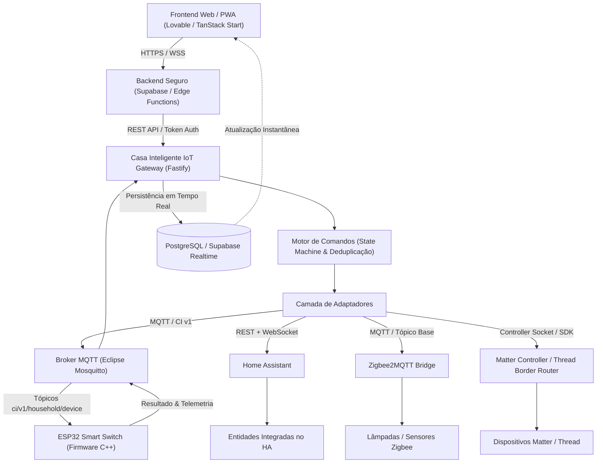
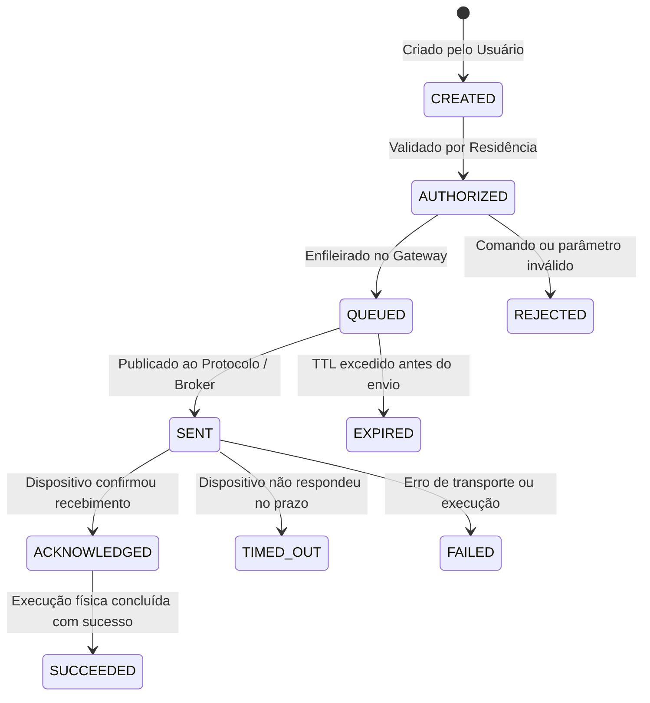

# Casa Inteligente IoT Gateway

Serviço oficial independente em **Node.js (LTS)** com **TypeScript**, **Fastify**, **MQTT**, **ESP32**, **Home Assistant**, **Zigbee2MQTT** e **Matter**.

Conecta a plataforma web **Casa Inteligente I.A.** a dispositivos físicos em rede local ou remota com confirmação real de execução e segurança multi-tenant.

---

## 1. Diagrama de Arquitetura



---

## 2. Máquina de Estados de Comandos

Todo comando enviado para um dispositivo físico atravessa uma máquina de estados explícita:



> [!IMPORTANT]
> **Confirmação Real**: O sistema **nunca** exibe "Dispositivo Ligado" apenas porque a mensagem MQTT foi aceita pelo broker. O status só transita para confirmado quando o dispositivo publica seu evento de resultado (`result`) e seu estado reportado (`state`).

---

## 3. Padrão de Tópicos MQTT (Protocolo CI v1)

```text
ci/v1/{householdId}/{deviceId}/command       (QoS 1 - Comandos enviados pelo gateway)
ci/v1/{householdId}/{deviceId}/result        (QoS 1 - Confirmação e resultado do dispositivo)
ci/v1/{householdId}/{deviceId}/state         (QoS 1, Retained - Estado reportado)
ci/v1/{householdId}/{deviceId}/availability  (QoS 1, Retained, LWT - online/offline)
ci/v1/{householdId}/{deviceId}/telemetry     (QoS 0/1 - RSSI, bateria, consumo, heap)
ci/v1/{householdId}/{deviceId}/config        (QoS 1 - Parâmetros de calibração)
```

---

## 4. Instalação e Execução Local

### Requisitos
- Node.js 20+ LTS ou 22+
- npm 10+
- Docker e Docker Compose (para broker Mosquitto)

### Passos
1. Entre na pasta do gateway:
   ```bash
   cd iot-gateway
   ```
2. Instale as dependências:
   ```bash
   npm install
   ```
3. Crie o arquivo de configuração local:
   ```bash
   cp .env.example .env
   ```
4. Inicie em modo de desenvolvimento com hot-reload:
   ```bash
   npm run dev
   ```
5. Acesse a documentação Swagger / OpenAPI:
   - `http://localhost:8080/docs`

---

## 5. Implantação com Docker Compose

Para implantar o broker Mosquitto e o Gateway no servidor local (Raspberry Pi, Mini-PC ou VM):

1. Gere o arquivo de senhas do Mosquitto:
   ```bash
   docker run --rm -v $(pwd)/deploy:/mosquitto/config eclipse-mosquitto:2.0.20 \
     mosquitto_passwd -c -b /mosquitto/config/mosquitto.passwd casa-gateway-user sua_senha_secreta
   ```
2. Inicie a stack:
   ```bash
   cd deploy
   docker compose up -d --build
   ```
3. Verifique os logs:
   ```bash
   docker compose logs -f
   ```

---

## 6. Endpoints Principais da API REST

| Método | Rota | Descrição | Autenticação |
|---|---|---|---|
| `GET` | `/health` | Diagnóstico sanitizado e status geral | Livre |
| `GET` | `/ready` | Prova de prontidão (Readiness Probe) | Livre |
| `GET` | `/api/v1/integrations` | Status detalhado de cada adaptador | Bearer Token |
| `POST` | `/api/v1/integrations/home-assistant/test` | Teste de conexão com o Home Assistant | Bearer Token |
| `POST` | `/api/v1/integrations/mqtt/test` | Teste de conectividade com o Broker MQTT | Bearer Token |
| `GET` | `/api/v1/devices` | Lista dispositivos unificados descobertos | Bearer Token |
| `POST` | `/api/v1/devices/:id/commands` | Envia comando com confirmação e TTL | Bearer Token |
| `GET` | `/api/v1/commands/:commandId` | Consulta status do comando na máquina de estados | Bearer Token |

---

## 7. Execução dos Testes Automatizados

O gateway inclui suíte de testes com Vitest cobrindo:
- Máquina de estados e transições de comandos;
- Proteção contra comandos duplicados (replay attacks);
- Expiração e controle de timeouts;
- Validação de schemas Zod;
- Bloqueio de acessos sem autenticação / tokens inválidos;
- Sanitização de credenciais em endpoints de health.

Para executar os testes:
```bash
npm test
```
